# Duck Box

A pirate "drop a duck / take a duck" box for our stateroom door on a Disney cruise, with a counter in it.

If you haven't run into cruise ducking: people bring rubber ducks on board and hide them around the ship for others to find. A lot of families also put a box on their cabin door so anyone walking past can drop a duck in the top or take one off the shelf at the bottom. Ours keeps score. Two light beams see every duck that goes in and every hand that reaches in. A small screen on the front shows the tally in pirate talk, and four LEDs behind the duck on the lid flicker like a candle. It runs on three AA batteries and holds to a steel door with six magnets.


| Lid off | Back |
|---|---|
| 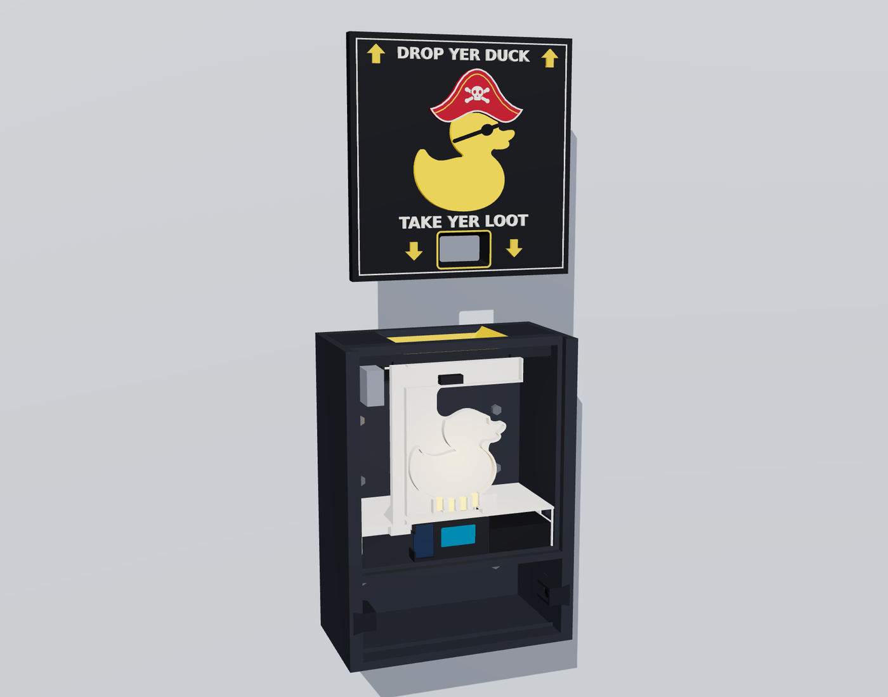 | 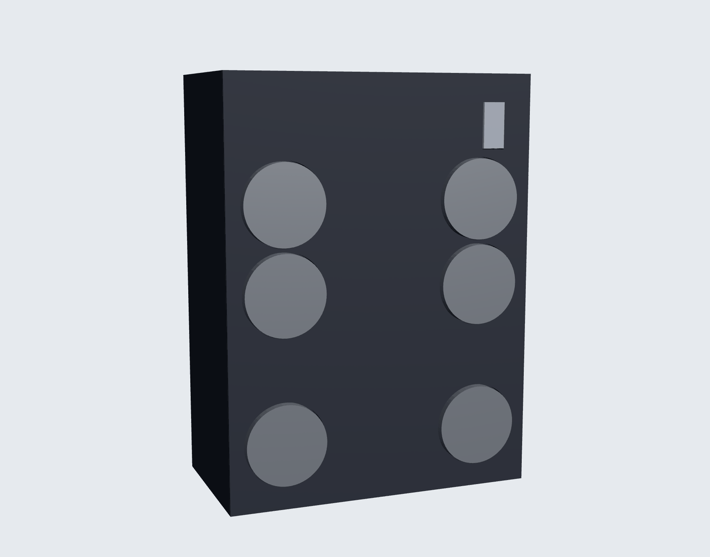 |

These are renders of the actual print files, not concept art.

## Credit where it's due

The box itself started as **[Cruise Duck Dropbox - Drop a Duck/Take a Duck](https://makerworld.com/models/2825520) by The Duck Spot** on MakerWorld (the file I downloaded calls it "Drop a Duck/Take a Duck Box With Locking Peg"). The shape, the shelf, the sliding lid and the locking peg idea are The Duck Spot's. Go give it a boost.

By the end I had changed almost every piece of it: new insides for the electronics, a magnet back, a reworked insert and funnel, a pirate lid, sensor pockets. The model is under MakerWorld's Standard Digital File License, though, and that license doesn't allow remixes to be hosted anywhere else. So the parts built on that mesh are **not** in this repo as STL files. What's here instead is the script that makes them. You download the original model yourself, run one command, and get exactly the files I printed (same bytes, I checked). Everything I designed from scratch is in [`prints/`](prints) ready to slice.

## What's in here

```
firmware/   PlatformIO project for the Heltec board (C++, Arduino core)
prints/     STLs for the parts I designed from scratch
cad/        Python that builds every print file from The Duck Spot's 3MF
docs/       renders, assembly steps and wiring pictures, all made from the model
render/     the three.js page and script that make the renders
```

## Parts list

Electronics:

- **Heltec WiFi LoRa 32 V2.** It has to be the V2. The V1 uses GPIO32/33 for the radio and the V3 is a different chip. I used it because I had a spare and it has the OLED built in. The radio and WiFi are switched off.
- **Two IR break-beam pairs**, the kind with a 2-wire emitter and a 3-wire receiver (red, black, white signal). One goes across the drop hole and one across the front of the shelf. Mine are 13.85 mm deep including the bulb. The pockets in the insert and the shelf blocks are sized for that, so measure yours.
- **Four 5 mm LEDs** (yellow or warm white) and **four 150 ohm resistors**.
- **3 x AA holder with an on/off switch.** Use lithium cells (non-rechargeable).
- **One 1N4001-1N4007 or 1N5817-1N5819 diode** in the battery's red lead. See "Power" for why. It isn't optional.
- **Six screw-on magnets** and six metal washers for under the screw heads.
- Hookup wire, heat shrink, a little 1.75 mm filament (it pins the drop sensors in place).

Tools: soldering iron, a multimeter, helping hands, and a heat gun or lighter for the shrink.

## Printing

Everything was printed in PLA at 0.2 mm on a Bambu A1 with the AMS lite. The STLs are already turned the right way up for the bed.

**Parts in `prints/`:**

| File | Colour | Notes |
|---|---|---|
| `06_tray_combined_white` | white | The big one: light tray, LED hood and electronics tray in one piece. White matters because it bounces the LED light up into the duck. See below for how I printed it. |
| `07_screen_cartridge` | black | Window face down. Print this first and test your board in it. The board clicks in behind two ledges. |
| `09_tray_stop` | black | Wide face down. Push fit through the tray's top arm. |
| `10_shelf_sensor_block_x2` | black | Print two. Tall and skinny, so add a 5 mm brim. |
| `11_magnet_test_coupon` | any | Optional. Try a magnet and screw in it before you commit to the long body print. |
| `12_screw_spacer_1mm_x6` / `2mm_x6` | any | Only if you don't have washers. Washers are better. |

**Parts you generate from the original model** (see "Building the print files"):

| File | Colour | Notes |
|---|---|---|
| `01_body_single_colour` | black | About 15 h / 490 g in a test slice. **Set wall loops to 4.** It gives a solid ring of plastic around every magnet screw. Supports on for the magnet recesses, but check that none get put inside the two small wire tunnels in the side walls or in the lid groove. There's also a two-part version with a white 1 mm back (`01_body_black` + `01_body_white_back`) if you want the back white. I went all black. |
| `02_lid_black` / `red` / `white` / `yellow` | 4 colours | The pirate lid: captain's hat, eye patch, DROP YER DUCK / TAKE YER LOOT. Drag all four in together, say yes to "load as one object with multiple parts", and set each part's filament. No supports. About 3 h 40 m plus colour changes. |
| `03_duck_cap_skin1.0` or `skin0.6_brighter` | yellow + black | The duck that glows. The 0.6 mm skin lets more light through. Face down. |
| `04_insert` | black | Top face down, **no supports**. The two sensor pocket floors are bridges, and support in there can't be removed. |
| `15_funnel_liner_yellow` | yellow | Drops into the insert's funnel. Small end down, no supports. |
| `13_locking_peg_stock`, `14_peg_key_stock` | any | Unchanged from the original. |

Time and weight figures are from slicer previews, not a stopwatch.

### Printing the one-piece tray

There's no way to print `06_tray_combined_white` without some overhangs. After trying it face down (a forest of tiny supports in places you can't reach) I printed it **upright with the duck facing up**. In Bambu Studio:

- Support type: **tree (organic)**
- **Build plate only**
- **Critical regions only**
- Brim: auto

The slicer said 5 h 39 m and 92 g, about half of that support. It takes longer and uses more filament, but the supports peel off clean and nothing touches the inside of the hood.

## Building the print files

You need Python 3 and the packages in `cad/requirements.txt`.

1. Download the 3MF from [The Duck Spot's MakerWorld page](https://makerworld.com/models/2825520).
2. Run:

```sh
python3 -m pip install -r cad/requirements.txt
cad/build.sh ~/Downloads/the-file-you-downloaded.3mf
```

The print files land in `build/stl/`. The script first checks the model inside the 3MF against `cad/original_model.sha256`. If the designer has updated the model since, it stops and tells you, because things may have moved. `DUCKBOX_IGNORE_HASH=1` makes it carry on anyway. Look over the results before printing if you do that.

After building, two checks run:

- **Export check.** Every print file has to map onto its place in the assembled box by a plain rotation, with no accidental mirror image. The lid has text on it, so a mirrored lid would be obvious, but a mirrored tray wouldn't be.
- **Assembly sweep.** Each part is slid along the path you'd actually use to put it in (tray from the front, insert down from the top, lid down the groove, peg in from the back) and checked for collisions with everything already in the box. It also checks that the parts that should be held in place are held, and that nothing blocks the drop beam.

Both have to say OK. They do on the files I printed.

The model uses one coordinate frame throughout, in printed millimetres: X runs down from the top of the box (0 to 225), Y runs left to right as you face it (0 to 168.75), and Z runs from the back against the door (0) to the front (87.5). The labels on the wiring pictures use the same numbers.

## Wiring

Everything goes to the header pins on the Heltec. I kept the header pins on and soldered straight to them, no DuPont plugs. Eight pins are used:

| Pin (as printed on the board) | Header position | What goes on it |
|---|---|---|
| **GND** | bottom 1 | One combined ground: battery black, all four sensor blacks, both LED ground wires, spliced into a single lead |
| **5V** | bottom 2 | Battery red, **through the diode**, band toward the board |
| **Vext** | bottom 3 | Both **receiver** reds, joined |
| **GPIO22** | bottom 9 | LED 2 + LED 4 (each through its own 150 ohm, joined after the resistors) |
| **GPIO17** | bottom 17 | LED 1 + LED 3 (same) |
| **GPIO32** | top 10 | Drop receiver white |
| **GPIO33** | top 11 | Shelf receiver white |
| **GPIO12** | top 16 | Both **emitter** reds, joined |

"Bottom" is the row with 5V and Vext. "Top" is the row with 3V3. Positions count from the USB end, and pin 1 on each row is GND. Go by the labels on the board, and use the positions only as a cross-check. When you flip the board over to solder on the pin tips, everything is mirrored: USB ends up on the right. [`docs/wiring/03_board_pins.png`](docs/wiring/03_board_pins.png) shows both sides.

**Leave empty:** bottom 4 (the second Vext), top 1 (the second GND), and top 17 (GPIO13), which sits right next to GPIO12. The firmware still toggles GPIO13 and GPIO23 from when the LEDs had a pin each. That's harmless with nothing connected.

Three rules that will save you a dead board:

1. **Emitter reds go to GPIO12, receiver reds go to Vext. Never join the two bundles.** The firmware pulses the emitters a hundred times a second to save power, and that only works if it controls their supply. An emitter on Vext stays lit all the time, and then the box reads its beams backwards and counts nothing.
2. **Nothing but the emitters on GPIO12.** It's a strapping pin, which the chip reads at reset. If it's held high, the board won't start. An emitter can only pull it down, so it's safe, but a wire to 3V3, Vext or 5V is not.
3. **The diode is not optional.** The 5V pin connects straight to USB 5 V. Without the diode, plugging in USB with the batteries connected pushes current back into lithium cells that can't take it. With the diode, you can plug in USB any time.

### How I did the harness

Do as much as you can off the board. Grounds especially: I spliced every ground into one wire before it got anywhere near the Heltec, so there's one fat joint on bottom 1 instead of eight wires fighting for two pins. I did the same for the two emitter reds and the two receiver reds, keeping them as **two separate bundles**.

The LEDs are wired as two pairs. Each LED keeps its own 150 ohm resistor on the long leg, and the resistors for 1+3 and for 2+4 are jumpered together, so only two signal wires leave the tray. Lay the LEDs in the tray to get the spacing, then take them out to solder. The short legs go onto two ground wires (bare T-joints are fine there), and those two get spliced into the combined ground. Leave about 10 mm of leg between each LED and its resistor, because the legs bend back through the opening into the hood.

Lead lengths that worked in this box:

- The **right drop sensor** route is about 30 cm and its lead is 30 cm, so it comes up short. Put the 2-wire emitter on the right and add 10 cm to it.
- The **left drop sensor** reaches (about 22 cm).
- The **shelf sensors** reach. Cut the plug off only after the wire is through the wall tunnel.
- Add about **12 cm to both battery leads**, so the holder slides all the way out to change cells.

Pictures, in the order you'll need them:

| | |
|---|---|
| [01 LEDs into the hood](docs/wiring/01_leds_into_hood.png) | Side cut and top view through the real tray: where the legs bend and where the resistors lie |
| [02 Cable routes](docs/wiring/02_cable_routes.png) | Front view, lid off: every cable from its sensor to the electronics bay |
| [03 Board pins](docs/wiring/03_board_pins.png) | Both sides of the Heltec with the 8 used pins marked |
| [05](docs/wiring/05_joint_b3_vext.png) to [10](docs/wiring/10_joint_b17_gpio17.png) | One picture per joint |
| [12 Closing up](docs/wiring/12_close_up.png) | What goes in, in what order |

`docs/breadboard_test_wiring.png` is the same circuit on a breadboard. I ran it that way for the battery test before building the box.

### Soldering order

I went bottom 1 (GND), bottom 2 (5V), bottom 3 (Vext), then top 10, top 11, top 16, and the LEDs last (bottom 9, bottom 17) because their wires are the shortest. Heat shrink on first, tin the wire and the pin, solder near the pin tip, shrink.

If you can't tell the emitter and receiver apart once the plugs are off: the emitter has two wires (red, black) and the receiver has three (red, black, white).

### First power-up

Power it from USB first. Write down the LAST RUN number before doing anything else. Hold PRG during start-up for the beam test, then switch to batteries and make sure it boots the same way through the diode.

## Assembly

The order matters, because some parts block others. The tray has to go in before the shelf sensor wires, and the board and battery go in before the insert.

| | |
|---|---|
| 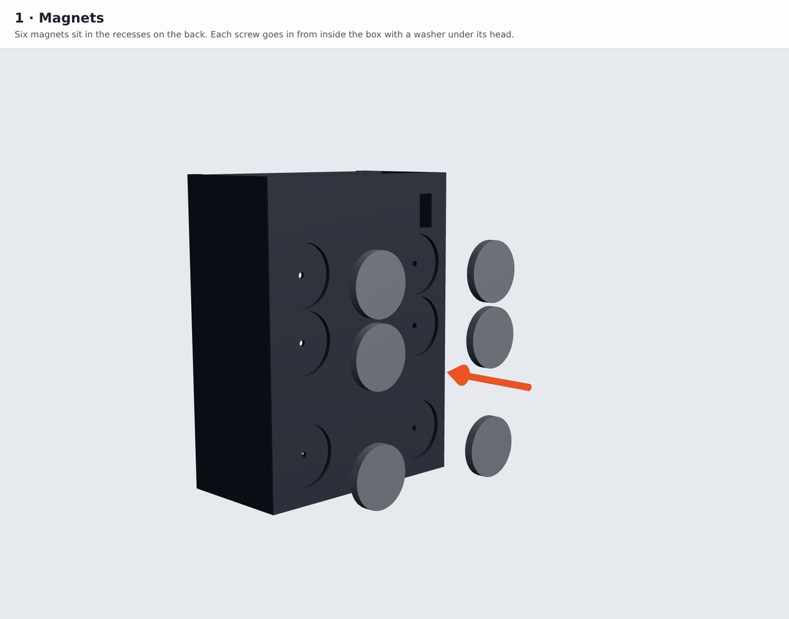 | 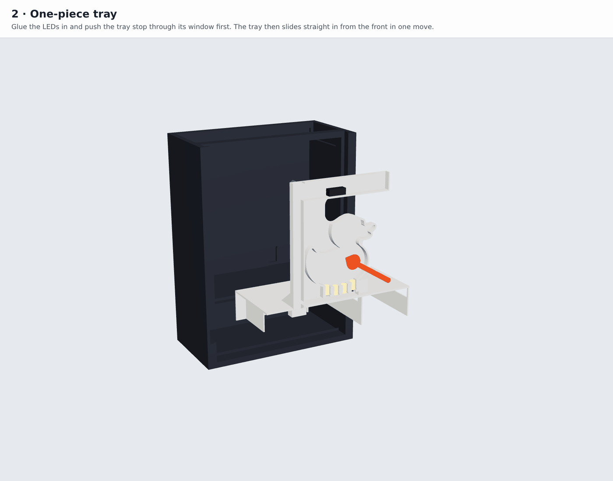 |
| 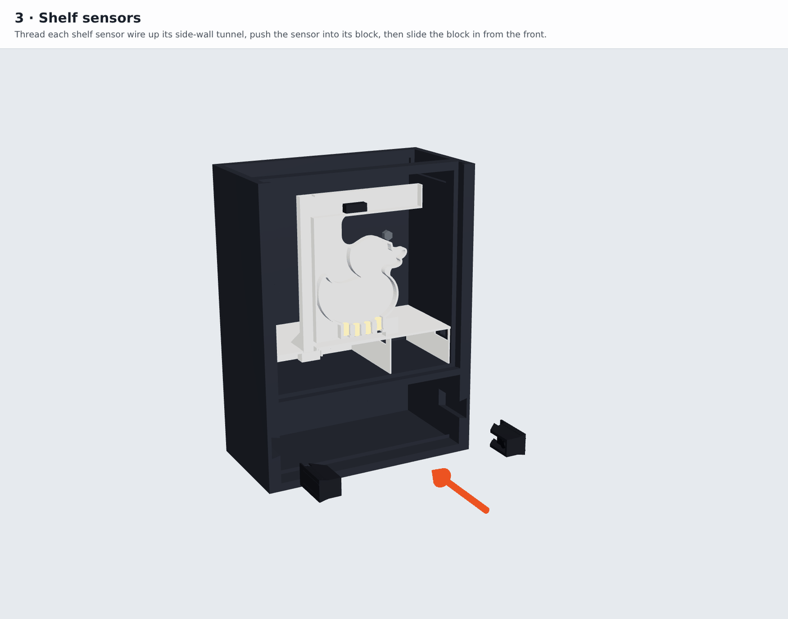 | 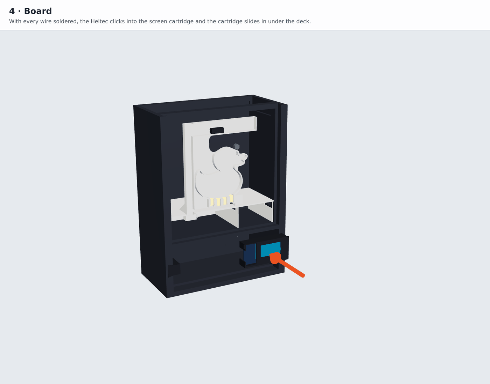 |
| 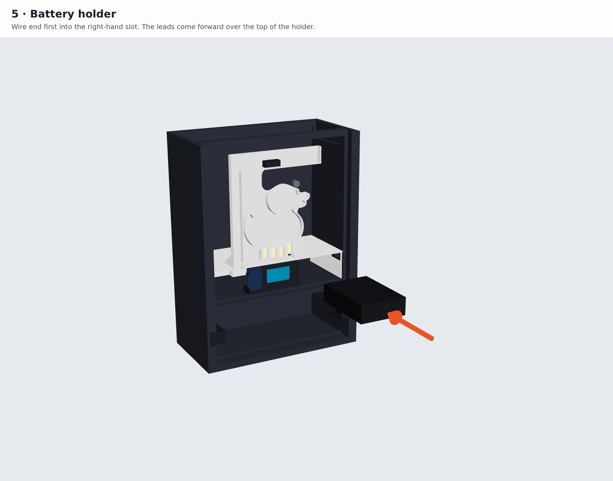 | 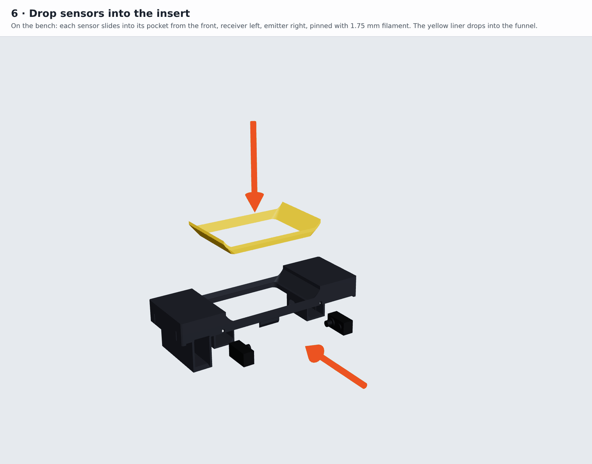 |
| 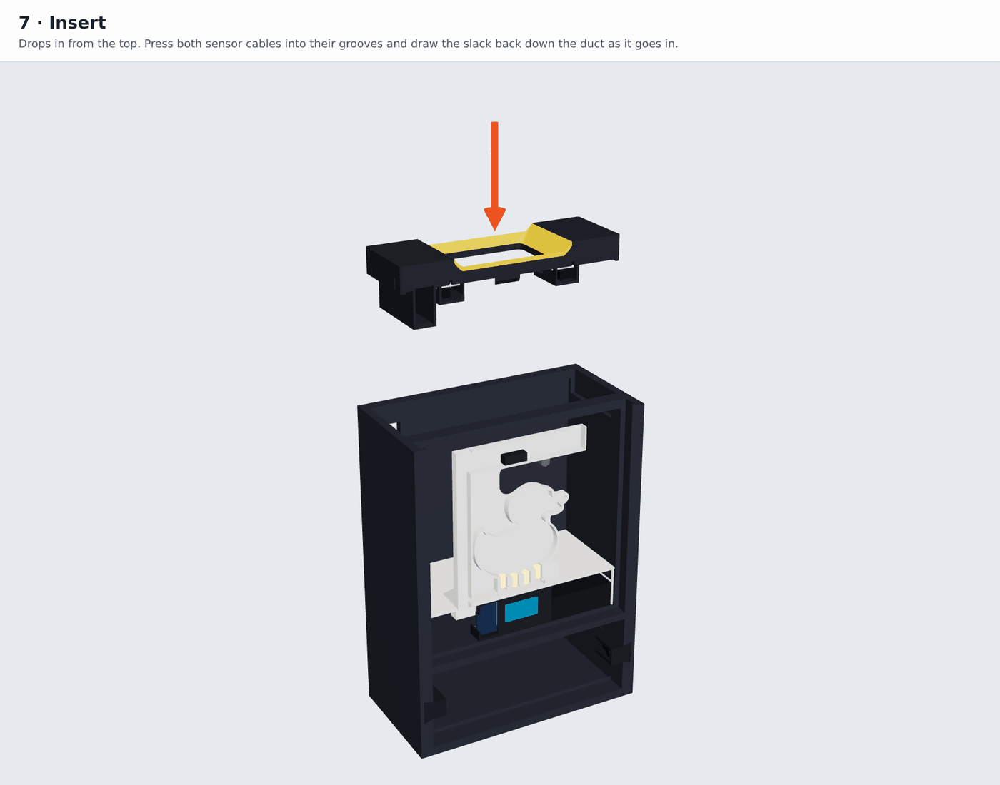 | 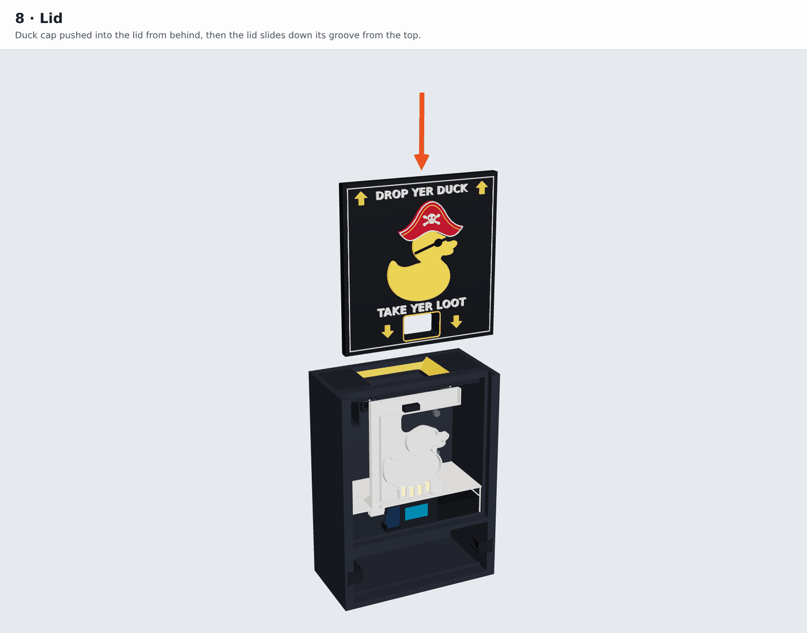 |
| 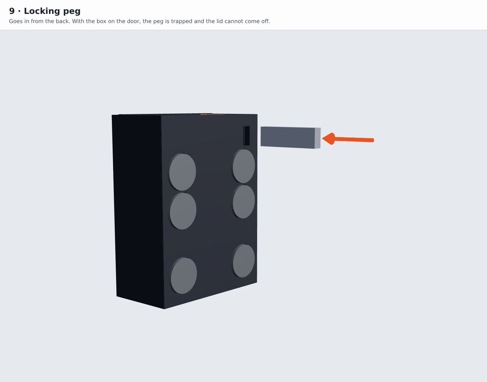 | |

Any work inside later means taking the box off the door, because the peg comes out from the back.

## Firmware

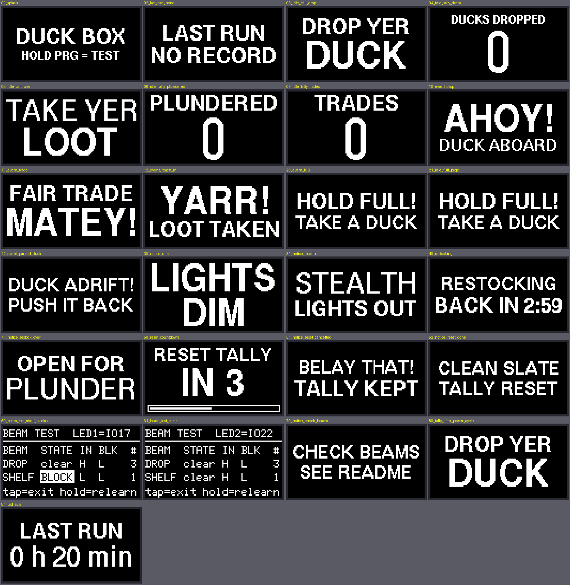

PlatformIO, Arduino core, versions pinned in `platformio.ini`.

```sh
pipx install platformio
cd firmware
pio run -t upload       # batteries disconnected, or the diode fitted
pio device monitor      # 115200 baud
```

If the upload won't connect: hold PRG, tap RST, let go of PRG, and try again. macOS and Windows may need the Silicon Labs CP210x driver.

What it counts:

- **Ducks dropped:** one per duck through the drop beam.
- **Plundered:** one per hand reaching into the shelf. It can't tell how many ducks a hand took.
- **Trades:** a drop and a reach-in within 60 seconds of each other, in either order.
- **HOLD FULL:** the drop beam is blocked for 4 seconds because the pile has reached it. By my estimate from the model that's 3 or 4 ducks deep.
- **DUCK ADRIFT:** something has sat in the shelf beam for 15 seconds, usually a duck pushed too far forward.

The PRG button is behind the lid (use a pen tip):

| Press | Does |
|---|---|
| Short | Normal, Dim, Stealth (screen and LEDs off, still counting), back to Normal |
| Double | Restocking: nothing counts for 3 minutes, so you can refill the shelf without padding the score |
| Hold 5 s | Reset the tallies (countdown first; let go to cancel) |
| Hold at power-on | Beam test mode |

Tallies are saved to flash 5 seconds after the last change, so a power cut costs you at most the last duck. Every pin and tunable number is in `firmware/include/config.h`, and every word the box says is in `firmware/src/phrases.h`, if you'd rather it said something else.

The tests run on a normal PC, with no board needed:

```sh
cd firmware
sh native_tests/run.sh       # unit tests
sh native_tests/run_sim.sh   # whole-firmware simulation (run `pio run` once first, it needs the U8g2 library)
```

`firmware/README.md` goes into much more detail: the power-saving design, the serial log, the beam test, troubleshooting, and where every pin assignment was checked.

## Power and battery life

To get days out of three AAs, the firmware lights the beam emitters for a fraction of a millisecond, a hundred times a second, reads the receivers, and sleeps the processor in between. The candle LEDs are pulsed in the same cycle. The screen stays on.

Measured: a fresh set of lithium AAs ran the breadboard build for about **68.5 hours** (Sunday 4:21 PM to Wednesday about 12:50 PM). When I pulled them, each cell read about 1.49 V resting. Forum reports (not a datasheet) put that close to empty for a lithium AA, where a fresh one reads about 1.8 V. That's short of the three and a half days I'd estimated on paper.

For a cruise of five or more nights, that means one swap. I'm doing it the morning of day 3 and bringing a third set as a spare. The LAST RUN line on the start-up screen tells you how long the previous set lasted, so you can see how yours are doing.

The power switch is on the battery holder inside the box.

## Mounting

Six magnets sit in recesses on the back, each held by a screw from inside with a washer under the head. The washers spread the pull over more plastic, and the 4 wall loops on the body are for the same reason. The magnets stand about 3 mm proud of the back. That's enough for the end of the locking peg to clear the door.

Disney's door decoration rules changed in June 2026. As reported ([Cruise Fever](https://cruisefever.net/new-disney-cruise-line-doorway-decoration-rules-starting-june-3/), [Disney Food Blog](https://www.disneyfoodblog.com/2026/05/29/7-new-rules-just-hit-disney-cruise-line/)): magnets only, no tape or adhesives, decorations on the door itself and not the walls around it, nothing that plays sound, music or video, and don't put anything valuable on the door. Magnets won't stick to the wood-finish Concierge doors on the Dream and Fantasy. This box makes no sound, and the screen shows a text tally, not video. Check the current rules for your ship before you sail anyway.

## License

The firmware, scripts, the parts in `prints/` and the pictures in `docs/` are mine, under the MIT license (see `LICENSE`). The Duck Spot's model is not included and stays under its own license on MakerWorld. The files `cad/build.sh` makes from it are for your own printing.
